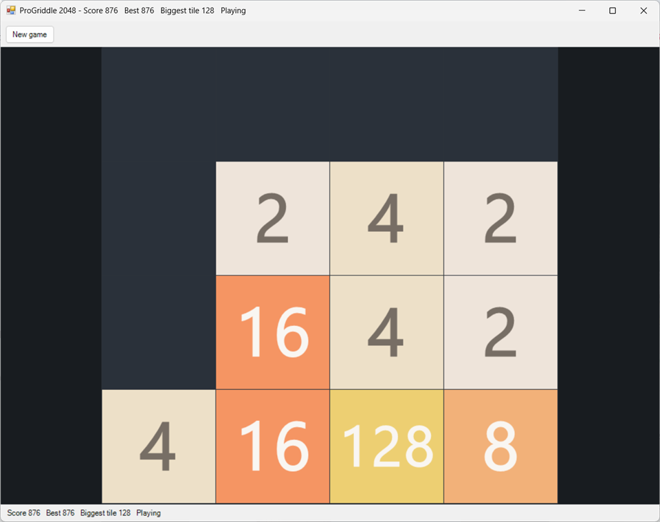

# 2048



Slide the tiles, join the matching pairs, and make 2048. A turn based game on a small board, played entirely from the keyboard. Playable now.

## Playing it

From the repository root, or from the Cookoff (`cookoff.bat`), where it has an orange button of its own:

```
"C:\Progress\OpenEdge\bin\prowin.exe" -T "%TEMP%\ProGriddle" -l 1024 -p tools/launch.p -param "run/run-2048.p"
```

`tools/launch.p` sets the PROPATH and then runs the named program. Optional entries after the program name: a settings file (`default` for `%APPDATA%\ProGriddle\settings.json`), a number of seconds after which the window closes by itself, and a seed for the new tiles. The automated checks use all three.

### Controls

| Input | What it does |
|---|---|
| Arrow keys, or W A S D | Slide every tile as far as it goes toward that edge |
| R or F2, or the New game button | Start again |

There is nothing to click. A key that would move nothing is ignored.

### The rules

The board starts with two tiles, each a 2 or (one time in ten) a 4. A move slides every tile toward one edge as far as it will go. Two equal tiles that meet join into one tile of the next power of two, and the new tile's value is added to the score. After every move that changed the board, one new tile (a 2 nine times in ten, otherwise a 4) appears in a random empty cell.

- A tile made by a join does not join again in the same move, so a row of 2 2 4 slides left to 4 4, not 8.
- In a run of equal tiles the ones nearest the edge being moved to join first, so 2 2 2 slides left to 4 2 and right to 2 4.
- A move that changes nothing is not a move: no new tile, no turn counted.
- Making a 2048 tile says so once and the game goes on, because the score keeps counting.
- The game is over when the board is full and no two neighbours are equal. GAME OVER is shown over the board and the keys do nothing until you start again.

The largest tile is 2^20 (1,048,576). Two of them do not join, which no real game gets near.

The status line (and the window title) reads `Score 1234   Best 5678   Biggest tile 256   Playing`.

## Settings

| Key | Meaning | Default |
|---|---|---|
| `2048.width`, `2048.height` | Board size in cells, 2 to 8 (read when the game starts) | 4, 4 |
| `2048.best` | The best score, kept by the game: a score that beats it replaces it at once | 0 |

The window also saves `window.width`, `window.height`, `window.x`, `window.y` and `window.maximised` by itself. The best score is one number for every board size.

## How it uses the framework

| Part | Used here |
|---|---|
| Archetype | Turn based: `TilesGame` implements `ITurnBasedGame` on `AbstractGame` |
| Grid | One layer called `view` on an `ArrayStore`, holding the power of two of each tile (0 empty, 1 a 2, 11 a 2048) |
| Controller | `TurnController`, with no clock |
| Window | The generic `GameWindow`, told about the game through `TilesInput` (the arrow keys come in through `HandleKey`, as they do for Tetris) |
| Look | `TilesLook`: a palette of the familiar tile colours and the glyph (the number) of each power. `GridView` draws a glyph of three or more characters smaller so `2048` and `131072` fit a cell |
| Randomness | An injected `IRandom` places and chooses every new tile, so a seeded one gives the same game every time |
| Settings | `JsonFileSettings`, read by `run/run-2048.p` and by `TilesInput` |

The namespace is `ProGriddle.Games.2048`. A namespace can begin with a digit but a class name cannot, which is why the classes are called `Tiles...`. Source: `src/ProGriddle/Games/2048/`. The composition root is `run/run-2048.p`.

| Class | Job |
|---|---|
| `TilesGame` | The rules: sliding and joining, new tiles, score, won and over |
| `TilesInput` | What the window needs: the keys, the status line, the GAME OVER banner, the "2048" notice and the best score |
| `TilesFactory` | Builds the grid (an `ArrayStore` of one layer) and a game on it |
| `TilesLook` | The colours, the glyphs and the text symbols the tests use |

## Tests

All under `tests/ProGriddle/Games/2048/`.

| Test class | What it proves |
|---|---|
| `TilesGameTests` | Sliding in all four directions, joining (pairs, runs, gaps, once per move), the score, new tiles in the cell the random source picks, moves that change nothing, winning, game over, `StartWith`, the contract errors |
| `TilesInputTests` | The keys, the status line, the banner, the notice, the best score and the members the game leaves empty |
| `ScriptedRandom` (in `tests/ProGriddle/Core`) | Not a test: a random source that returns numbers given to it, so a test chooses exactly where a new tile appears |

Run them with `powershell -NoProfile -ExecutionPolicy Bypass -File tools/run-tests.ps1 -Filter "Tiles*"`. The window is checked by `tools/gui-smoke-2048.ps1`, which takes over the keyboard and mouse for a minute or two.

## Design notes

- **One layer, and the power rather than the value.** The tile's value (2, 4, 8, ...) is `2^power`, so the layer holds 0 to 20 and a palette and a glyph list of 21 entries cover every tile. The tests write a board as text, one character per cell (`.` empty, `1` for a 2, `B` for a 2048).
- **A lane at a time.** A move slides four lanes (rows or columns) with one routine that walks a lane from the edge being moved to, building the result in a scratch array made once, so a move allocates nothing. Moving right is the same walk from the other end.
- **The random source is asked in a fixed order**: the kind of tile (a number below 10, 0 means a 4), then the cell (a number below the count of empty cells). That order is part of the game's contract because the tests script it.
- **Winning does not end the game.** The classic game offers to keep going, and here the 2048 notice appears once and play simply carries on.
- **The framework changed once for this game**: `GridView` shrinks a glyph of three or more characters so it fits its cell, which any numbered game could use.
