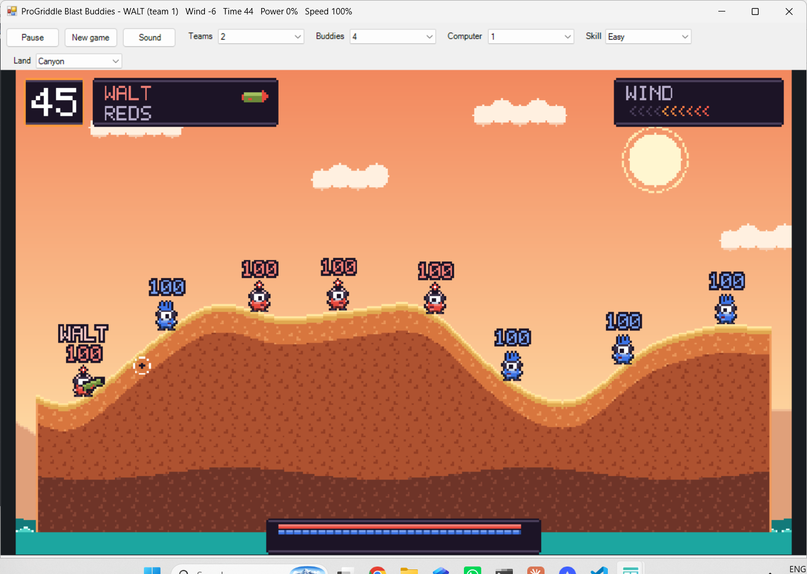

# Blast Buddies



Turn based artillery on ground that blows away. Two to four teams of three or four round, glossy buddies (one big lens each, in four team colours) stand on rolling hills over the sea. Each turn one buddy walks, aims, charges and fires a bazooka, the rocket bends in the wind, and every blast digs a hole. Knock the other teams into the holes, or into the water. The last team standing wins. A person can play against the computer, or two or more people can share the keyboard turn by turn.

The picture is the designer's "Sunny Side" look (`docs/design/blast-buddies-art.md`): a noon sky with a sun, far hills and drifting clouds, three themes of land (Meadow, Canyon and Candy) coloured by one rule from how deep each pixel is below the nearest air, a sparkling sea, and explosions with a flash, a fireball, a shock ring, smoke and flying earth. The board is 384 x 240 pixels in direct colour, scaled to fill the window.

This first release has the bazooka only. The grenade, dynamite, shotgun, air strike, crates, mines and the weapon menu are planned (Phase B in `PROGRIDDLE_PLAN.md`).

## Playing it

From the repository root, or from the Cookoff (`cookoff.bat`), where it has a button of its own:

```
"C:\Progress\OpenEdge\bin\prowin.exe" -T "%TEMP%\ProGriddle" -l 1024 -p tools/launch.p -param "run/run-blastbuddies.p"
```

Optional entries after the program name: a settings file (`default` for `%APPDATA%\ProGriddle\settings.json`), a number of seconds after which the window closes by itself (for scripted checks), and a seed for the land, the wind and the computer (for scripted checks).

### Controls

Only the buddy in turn is steered, and only on a turn played by a person.

| Input | What it does |
|---|---|
| Left, Right | Walk, one pixel every 40 ms for as long as the key is held. Steps up a rise of 3 pixels or less, walks down a slope, and falls off a ledge |
| Up, Down | Raise or lower the aim, a step every 3 frames, from straight up to straight down (33 of the 64 headings) |
| Enter | Hop (6 pixels high). Enter twice within a quarter of a second makes a backflip (11 high, 9 back) |
| Space | Hold to build power, let go to fire. The power shows as a line of dots growing along the aim, gold to red; at full power (1.5 s) the shot goes by itself. On the title screen it starts the match, on the winner screen a new game |
| P | Pause and run. A paused game shows its band with PAUSED |
| R or F2 | A new game (back to the title) |
| M, or the Sound button | Sound on or off (only when the machine has a sound device) |
| + or - | Faster or slower, in steps of 10 percent of the real 60 frames a second (10 to 200). The choice is kept |

Walking, aiming and firing are held keys, not events, so they work together. A key repeat does not repeat a hop or a shot.

The toolbar has five lists. Choosing from one starts a new game with that setup, and the window keeps the choices:

| List | Choices | Setting |
|---|---|---|
| Teams | 2, 3, 4 | `blastbuddies.teams` (default 2) |
| Buddies | 3 or 4 in each team | `blastbuddies.buddies` (default 3) |
| Computer | None, 1, 2 or 3 of the last teams (never all of them, so a person always has the first) | `blastbuddies.computer` (default 1) |
| Skill | Easy, Normal, Hard | `blastbuddies.skill` (default Normal) |
| Land | Meadow, Canyon, Candy, or Random (a new look for every map) | `blastbuddies.theme` (default Meadow) |

Other settings: `blastbuddies.speed` (the speed, default 100), `sound.on` and `sound.volume`, and the window's own size and position.

### The rules

- **The match.** The title screen shows the name, four goons being silly and a rocket that comes in and bites the last S of BUDDIES. Space starts the match: the buddies come down by parachute, one every 150 ms in turn order. Then each turn has a banner (the buddy, its team, `COMPUTER` for the computer's), a turn of 45 seconds, and the settling of everything.
- **Turns.** The teams take turns in order, skipping a team with no living buddy, and each team plays its own buddies in rota. The wind is rolled for every turn, from -10 to 10, and shows as ten chevrons that point the way it blows.
- **Firing.** The rocket leaves the muzzle at 0.5 pixel a frame at no power up to 6 at full power, and gravity and the wind bend its path. It blows up on the ground or on a buddy (the buddy that fired it is safe for the first 8 frames), and is lost in the water, off the sides or after too long in the air. A shot above the top of the screen comes back down, with a small arrow in its column at the top. After a shot the buddy has a retreat time of 3 seconds to walk away.
- **The blast.** Radius 20: every pixel within it becomes air, and the ground out to 3 pixels beyond is scorched, which glows through the Blast colours and cools to dark over 600 ms. A piece of ground of 24 pixels or fewer that is cut off is turned to air at once and thrown out as debris (the crumb rule), so no specks float in the sky; bigger floating pieces stay. A buddy whose middle is within 28 pixels takes damage that falls in a straight line from 50 at the centre to nothing, and is thrown away from the blast at a speed that falls the same way.
- **Falling.** A fall of more than 24 pixels from the highest point costs 1 health for every 2 pixels beyond. Reaching the water (row 226) or leaving the sides of the map drowns a buddy at once.
- **Dying.** When everything has stopped, buddies at 0 health (or drowned) die one at a time, team 1 first: alarm frames and a skull, a puff of smoke, then a gravestone rises out of the ground with a halo over it. The gravestone stays and falls with the ground. If the buddy in turn dies, the turn ends.
- **Winning.** The last team with a living buddy wins, and its buddies dance on the dimmed last picture. If the last buddies of all the remaining teams die together, it is a draw (NOBODY WINS).

### The computer

The computer plays the last teams. At the start of its turn it tries shots: from where it stands and from the places 15 and 30 steps of walking either way would take it, at the two nearest enemies, over seven aims and four to seven powers, flying each one through the ground with the same numbers the game uses and scoring the blast where it lands (the damage to enemies, with a bonus for a kill, less 1.2 times the damage to its own team and itself). It does at most 6 flights a frame, so the window never waits, and a thought bubble bobs over the buddy for at least a second. Then it walks to the place, aims, charges and fires with the same controls a person has.

The skill is the size of the mistake it makes in the aim and the power it picks: none on Hard (which also looks closer round the best shot), a little on Normal, a lot on Easy. All its choices come from a seeded random source, so a seeded game plays the same every time.

## Design notes

- **The numbers** (health 100, the turn, the retreat, gravity 0.15 pixel a frame a frame, the wind, the speeds, the damage and knockback, the timings of every phase) are in one class, `BuddyRules`, and are first guesses to tune by feel. Positions and speeds are whole numbers in 256ths of a pixel, so a seeded game is the same every time.
- **The ground** (`Terrain`) is a 384 x 240 map with one byte a pixel (air, or ground with its scorch step). The colour of a pixel is worked out by the rule of the design (`ShadeAt`: scorch, then the grass bands by depth, then the lit edge, then bedrock, soil and deep with a fixed 16 x 16 speckle tile), and only the box a blast changed is coloured again. A radius 30 blast with its re-shade takes about 35 ms and its crumb check about 13 ms.
- **The land** is made by `TerrainGenerator` from a seeded random source: three sine waves, 1 or 2 caves, up to 2 floating islands, 10 columns of air at each side, and then `FindSpots` picks starting places that are flat, spread over the width and spaced out (all of 100 test seeds have room for 16 buddies).
- **The game and the picture are separate.** `BlastBuddiesGame` makes 60 frames a second out of the time it is given (`Advance` makes one frame, which is how the tests drive it), `BlastBuddiesPainter` draws it on the canvas of the game's grid, and `BlastBuddiesInput` is the window's view of it. The pictures are made from the designer's tiles by `tools/gen-blast-art.ps1` (`BuddiesArt`, `BuddiesLook`, `TerrainThemes`, all generated: change the design and run the script again). The effects are functions of the game's own clock.
- **The shake** moves the whole picture (`PixelCanvas:ShiftView`) by 2 pixels for 5 frames after a radius 30 blast and 1 pixel for 3 after a radius 20 one, and the HUD, which is drawn afterwards, does not shake.
- **The open edges.** Ground never touches the sides, the sea runs the whole width, and anything that goes past either side is lost like something that reaches the water.
- **What is not yet in:** the weapon menu and the other weapons, crates, mines, the wind streaks, and the damage and sinking details the design marks for later (bubbles under a sinking buddy, the dust on landing, the team mark on a gravestone). The painter still costs about 25 to 35 ms for a still frame and about 100 ms for the first frame after a blast, so the frame rate dips during an explosion; making it faster is on the list.

### Sound

New game, so it has sound (see [Sound](../framework/sound.md)): little blips for walking, hopping, backflipping and aiming, four rising ticks while the power builds, a whoosh for the shot and a quiet hiss that loops while a rocket is in the air, three sizes of explosion, a squeal for a hurt buddy, a long fall for one that dies, a splash, a two note call at the start of a turn, a tick in the last ten seconds, a fanfare for the winner and a falling pair for a draw. `BuddyCues` finds them from the game's running counts, and `BuddySounds` says what each sounds like.

## Tests and checks

- `tools/run-tests.ps1 -Filter "*Buddies*"` (the game's tests; the painter's tests build many games and take a minute or two).
- `tools/gui-smoke-blastbuddies.ps1` plays the real window (the title, Space, the arrival, a turn, a shot, pause, R, the saved window size). It takes over the keyboard for about a minute, so warn before running it. `tools/look-blastbuddies.ps1` saves a screenshot of the title screen without keys.
