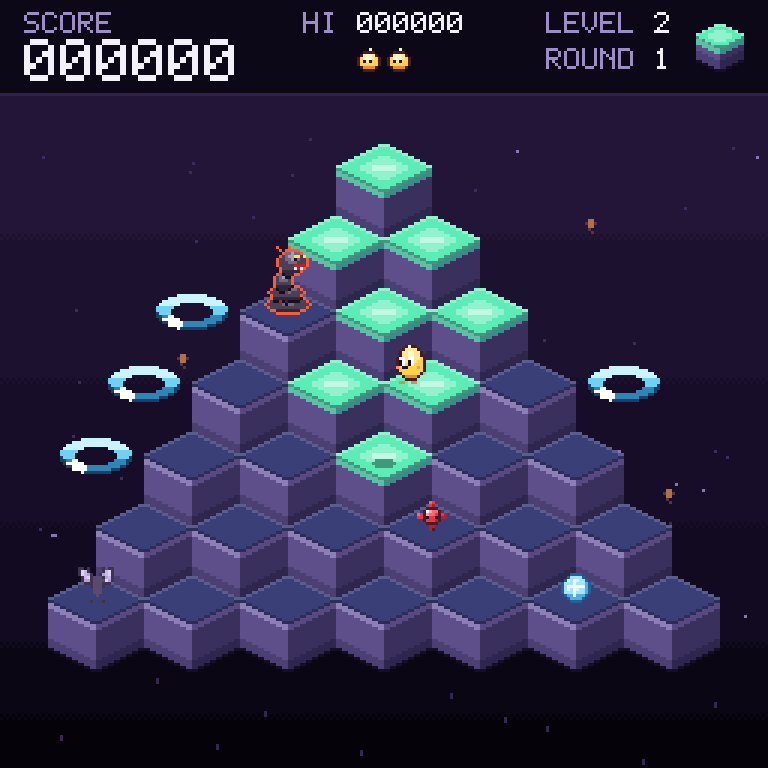

# Cuber

A hopping puzzle on a pyramid, in the look of the designer's "Dusk Lamps" (the design file is `docs/design/cuber-art.md`, an original set of lamps, a hero, enemies and a dusk sky; its own working title for the game is Lamplighter). Pip, a small gummy that glows from inside, hops down a pyramid of 28 stone lamps, and every lamp it lands on lights up. A smouldering Coil hunts it, red Thorns and a freezing Frost bounce down the pyramid, two moths put the lamps out again, and the edge is a long way down. Rings of light, the halos, wait at the sides to lift Pip home.

The rules are those of the 1982 pyramid hopper that the idea comes from. The names, the pictures and the numbers of the level table are the designer's own and ours.



## Playing it

From the repository root, or from the Cookoff (`cookoff.bat`), where it has a button of its own under Arcade:

```
"C:\Progress\OpenEdge\bin\prowin.exe" -T "%TEMP%\ProGriddle" -l 1024 -p tools/launch.p -param "run/run-cuber.p"
```

`tools/launch.p` sets the PROPATH and then runs the named program. Optional entries after the program name: a settings file (`default` for `%APPDATA%\ProGriddle\settings.json`), a number of seconds after which the window closes by itself, and a seed for the halos and the enemies (the last two are for scripted checks).

The title screen shows the name dropping in a letter at a time and Pip lighting a path down the middle of the pyramid, over and over. Space starts the game.

### Controls

The arrow keys are the pyramid seen at 45 degrees.

| Input | What it does |
|---|---|
| Up arrow, or W, or number pad 9, or E | Hop up and to the right |
| Right arrow, or D, or number pad 3, or C | Hop down and to the right |
| Down arrow, or S, or number pad 1, or Z | Hop down and to the left |
| Left arrow, or A, or number pad 7, or Q | Hop up and to the left |
| Space or Enter | Start, and start again after the game is over |
| P, or the Start and Pause button | Pause and carry on. PAUSED shows on a plate |
| R or F2, or the New game button | Back to the title |
| + and - | Faster and slower, in steps of 10 percent of the real speed, and the speed is kept |
| M, or the Sound button | Sound on or off (only when the machine has a sound device) |

A hop is asked for, not held: Pip makes it as soon as it stands, and the game remembers a wanted hop for 14 frames, so holding a key keeps Pip hopping and a key tapped while Pip is in the air is not lost.

### The rules

- **The pyramid** has 7 rows and 28 lamps. A lamp is a row (1 at the top to 7) and a column (0 to row - 1). Pip starts every life on the top one.
- **A hop** is 12 frames (200 ms), one lamp along a diagonal, and cannot be steered in the air. A hop that lands on nothing is a fall, off the front of the pyramid for a hop down and off the back for a hop up, and costs a Pip.
- **Lamps.** A lamp takes one landing to light on levels 1 and 2 and two from level 3 (a ring first, 10 points, then the glow, 25 points). From level 5 a landing on a lamp that is lit already puts it back a step. Light all 28 and the round is cleared: the white of a glint runs over the lamps, each halo left over pays 50, and the next round begins.
- **Rounds and levels.** Four rounds make a level, and the light changes every round (mint, rose, sky, lilac). The level sets the rules (the table below) and, with the round, the speed: the tempo goes from 0 to 12 and everything quickens with it.
- **The seed and the Coil.** After a pause a seed falls in at the top, bounces down at random and hatches into a Coil when it reaches the bottom row. The Coil hops the way that brings it nearest to Pip (65 times in 100 on the first round, to 89 at the top tempo, else at random). Touching either costs a Pip.
- **Thorns** bounce down at random and cost a Pip. They fall off the bottom row.
- **A Frost** bounces down too, and touching it freezes every enemy for 4 seconds (down to 1.5 at the top tempo) and pays 100. A frozen enemy stands still and is harmless, in ice colours, and blinks for the last second.
- **The moths** come from level 2: Snuff climbs the left edge and Puff the right, and each lamp they land on goes back a step. Landing on one catches it for 300.
- **Halos.** Four wait beside the pyramid on levels 1 and 2, three on 3 and 4, two after, in places chosen at random from the six (rows 3, 4 and 5, left and right). Hopping onto one lifts Pip back to the top over 1.2 seconds. Everything on the pyramid vanishes, except the Coil, which hops after Pip to the edge and falls off (500 points). A halo can be used once a round.
- **Pips.** Three in all (two spare, shown in the HUD), and an extra one at every 8000 points.
- **Phases.** READY for 1.5 seconds at the start of every life and round, the game, the death (a hit takes about a second, a fall a little more), the clear (3 seconds), and GAME OVER, which waits for the fire key after 1.5 seconds.

| Level | Hits to light a lamp | Moths | Lamp goes back when landed on | Halos |
|---|---|---|---|---|
| 1 | 1 | no | no | 4 |
| 2 | 1 | yes | no | 4 |
| 3, 4 | 2 | yes | no | 3 |
| 5 and on | 2 | yes | yes | 2 |

| Points | |
|---|---|
| A lamp lit | 25 |
| A lamp ringed (levels of two hits) | 10 |
| A Frost | 100 |
| A moth caught | 300 |
| The Coil falling off the edge | 500 |
| Each halo left at the end of a round | 50 |

## The look and the sound

The picture is drawn by `CuberPainter` on a 256 x 256 pixel canvas of direct colour, scaled to fill the window (`GridView:FitToWindow`). Everything in it comes from the designer's file `docs/design/cuber-art.md` through `tools/gen-cuber-art.py`, which writes `CuberTint` (the single colours), `CuberRow` (the 19 tone rows of five colours), `CuberLook` (the colours, the four lights and the stars), `CuberSprite` and `CuberArt` (78 sprites as strings of cells). Those five files are generated: change the design file and run `python tools/gen-cuber-art.py`, never edit them. The sprites use the digits 1 to 5 for the tones of whichever row the painter draws them with (Pip's row, a lamp's light), and a letter for each fixed colour.

The pyramid is kept in the picture's background. A lamp that changes is drawn whole and then the top rows of the two lamps under it (which cover its edge line), so a landing costs about three lamp pictures; a new round draws all 28. Pip, the enemies, the halos, the shadow, the glints, the freeze ring and the points are drawn every frame as functions of the game's own frame counts (`Frames`, `PhaseFrames`, and the frame of each hop), so a test sees the same picture for the same game. The title screen's intro is a function of the frame count too.

Sound is soft triangle waves, like glass lamps being lit (`CuberSounds`, `CuberCues`): a blip for a hop, a chime for a lamp, a lower note for the ring and for a lamp put out, a long fall, a thud for a hit, an arpeggio when a halo lifts Pip, fanfares for a round, a level, an extra Pip and a new game. `docs/framework/sound.md` describes how it works. Nothing loops.

## Settings

| Key | Meaning | Default |
|---|---|---|
| `cuber.hiscore` | The best score, kept by the game | 0 |
| `cuber.speed` | 20 to 100, the speed as a percentage of the real 60 frames a second; the + and - keys change it | 80 |
| `sound.on`, `sound.volume` | The sound (the M key and the Sound button switch it) | on, 50 |

The window also saves `cuber.window.x` and `cuber.window.y` by itself.

## How it uses the framework

| Part | Used here |
|---|---|
| Archetype | Real time: `CuberGame` implements `IRealTimeGame` on `AbstractGame`, and runs frame by frame with `Advance` (60 a second) |
| Grid | A 7 x 7 `ArrayStore` with one layer, `lamp` (0 dark, 1 ringed, 2 lit), the lamp at row r and column c in the cell at column c and row r - 1 |
| Controller | `RealTimeController` with a `WinFormsClock` |
| Painting | `CuberPainter` on a `PixelCanvas`, handed to the window's `WinFormsGridRenderer` (direct colour, no grid lines) |
| Window | The generic `GameWindow`, told about the game through `CuberInput` |
| Sound | `SoundBank`, `ToneSynth`, `SoundRenderer` and `WaveOutPlayer`, with `CuberCues` as the cue source |
| Randomness | An injectable `IRandom` (a `SeededRandom` in the run file, a `ScriptedRandom` in tests) decides the halos and the enemies' hops |
| Settings | `JsonFileSettings`, read by `run/run-cuber.p` and the input |

Source: `src/ProGriddle/Games/Cuber/`. The composition root is `run/run-cuber.p`.

| Class | Job |
|---|---|
| `CuberRules` | Every number, and the geometry of the pyramid (where a lamp, a foot and a halo are) |
| `CuberGame`, `CuberFactory` | The rules, and the 7 x 7 grid |
| `CuberPhase`, `CuberKind`, `CuberDir`, `CuberPipMode`, `CuberEnemyMode`, `CuberCue` | The named values, one enum each |
| `CuberInput` | The keys, the best score and the speed |
| `CuberPainter` | The picture |
| `CuberTint`, `CuberRow`, `CuberLook`, `CuberSprite`, `CuberArt` | The generated colours and sprites |
| `CuberSounds`, `CuberCues` | What each sound is, and when each one happens |

## Tests

`tests/ProGriddle/Games/Cuber/` has a test class for each of the classes above. The game is driven frame by frame with a `ScriptedRandom` that always says 1 (so a ball always hops down and to the right), a scene is built with `PlacePip`, `SetLamp`, `SpawnEnemy`, `SetEnemyRest`, `SetHalo` and `StopSpawns`, and a hop is `RequestHop` followed by 14 frames (Pip stands 2 frames after a landing, one frame starts the hop and 12 are the flight). The painter tests read pixels of the canvas (with `Effects` off, so the lanterns and motes do not get in the way), and one plays 900 frames through the real painter. `tools/preview-cuber.p` draws a scenario into a BMP with no window and no keyboard:

```
_progres -b -T "%TEMP%\ProGriddle" -p tools/preview-cuber.p -param "play|file.bmp"
```

The scenarios are `title:300` (the number of frames of the title screen), `ready`, `play`, `three`, `over` and `clear:30`.

There is no window smoke test yet. A run of the real window has not been done: only the headless runs above.

## Performance

A frame of drawing takes about 10 to 13 milliseconds in a headless run (the canvas copies dominate, as in the other pixel canvas games), and drawing all 28 lamps at the start of a round takes about a quarter of a second, during the READY banner.
