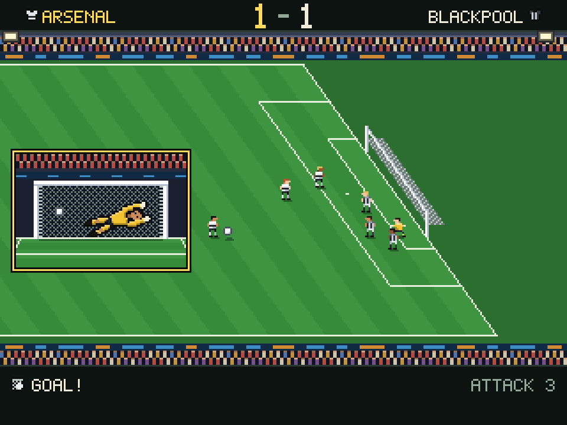

# Football Manager

A football management game, a port of the rules of Kevin Toms' 1982 Football Manager, in the designer's "Chalk and Floodlights" look (the design file is `docs/design/footballmanager-art.md`: a chalkboard in a wooden frame for the menus and a floodlit night match). You take a small club from the fourth division, pick a team each week, watch the match as a few highlights you cannot change, then mind the money (gate, wages, rent, a bank loan, transfers) and try to climb to the top. The rules, the numbers and the clubs and players are the original's; the game logic is written from `docs/design/footballmanager-rules.md`, not copied from the 1982 listing. The pictures are the designer's.



## Playing it

From the repository root, or from the Cookoff (`cookoff.bat`), where it has a button of its own under Strategy:

```
"C:\Progress\OpenEdge\bin\prowin.exe" -T "%TEMP%\ProGriddle" -l 2048 -p tools/launch.p -param "run/run-footballmanager.p"
```

Optional entries after the program name: a settings file (`default` for `%APPDATA%\ProGriddle\settings.json`), a number of seconds after which the window closes by itself, and a seed for the game (the last two are for scripted checks).

### The week

1. **The manager's office**: continue to the next match, look at the squad and sell a player, take or pay back a loan, see the status, or change the skill level.
2. **Pick the team**: eleven of your squad, with your five numbers (energy, morale, defence, midfield, attack) against the opposition's.
3. **The match**: up to 22 attacks, each shown as a short highlight on the pitch and, for a shot, a close up of the goal mouth.
4. **Full time, the other results, the table, the accounts** (gate money in, wages, rent and interest out), and at the end of the season the prize, promotion and relegation.
5. **One transfer offer**: bid for the player or let him go.

A season is 15 league matches (each club once, home and away in turn) and the F.A. Cup (a tie every third week while you are still in it). The top three go up, the bottom three go down. You start in the fourth division with a random squad of 12 and no money: going over the bank's loan limit after a week's bills gets you sacked.

### Controls

What the keys do depends on the screen.

| Screen | Keys |
|---|---|
| Your name | Type it, Backspace rubs out, Up and Down choose the level, Enter goes on |
| Pick a club | Arrows move, Page Up and Page Down (or Tab) change the division, Enter picks, Esc goes back |
| Your colours | Left and Right choose white or black, Enter starts the game |
| Office | Up, Down and Enter, or C continue, A squad and sales, L loan, P pay back, S status, V level |
| Squad | Up and Down choose, Enter offers the player for sale, Esc goes back |
| Loan, pay back | Type the amount, Enter, Esc goes back |
| A sale | Y sells him, N keeps him (he may be upset) |
| Pick the team | Up and Down choose, Space or Enter picks or drops a player, K kicks off |
| The match | Space skips the highlights, and then goes on |
| Full time, results, table, accounts, season end | Space or Enter goes on |
| Transfer offer | Type a bid, Enter, P or Esc lets him go |
| Sacked | Enter starts again |

The window's own keys work too (P pauses the highlights, R or F2 starts a new game).

## How it is built

| Part | Where |
|---|---|
| The state of a game (clubs, players, table, money) | `FootballWorld` |
| The numbers of the original | `FootballRules` |
| The rules, as helpers that work on a world | `TeamStrength`, `Opposition`, `Squad`, `Bank`, `Market`, `LeagueTable`, `MatchDay` |
| The match: five rounds of rolls, then each attack worked out cell by cell on the original's 32 x 22 pitch with its diagonal goal lines | `MatchEngine`, `PitchAttack`, `MatchResult` |
| The week from screen to screen, and the highlights clock | `FootballGame`, `Highlights` |
| The keyboard and the screen state | `FootballInput`, `FootballUi` |
| The picture | `FootballPainter` (the pitch and the match) and `FootballScreens` (every menu screen), on a 320 x 240 pixel canvas |
| The designer's art, generated from the design file | `FootballTint`, `FootballRow`, `FootballLook`, `FootballSprite`, `FootballArt` (`python tools/gen-footballmanager-art.py`; change the design, never these files) |

Every random number comes from the source the game is given, so a seeded game plays the same every time. A ball that has not left the pitch after 40 steps counts as wide, so an attack always ends: the one place the port differs from the original. The original's quirks are kept (for example a cup tie changes morale twice).

`tools/preview-footballmanager.p` draws any screen into a BMP with no window, from a list of keys: `_progres -b -l 2048 -p tools/preview-footballmanager.p -param "keys:B,O,B,Return,Return,Return,C,K:1500|file.bmp"`. There is no window smoke test yet and the window has not been run by the author of this page, only the preview.

Each attack shows the dribble, the ball crossing the pitch to the goal with its trail, the close up of the goal mouth (the net ripples and the crowd jumps for a goal). Not drawn yet: the close up shake, the title screen and the trophy cabinet.
