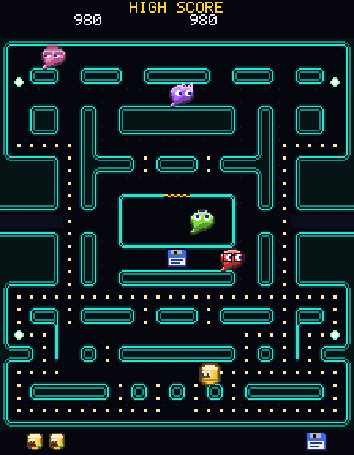

# FOR EACH



Dibby, a database drum, visits every bit of data in a dark data centre while four phantoms hunt him. A maze game on a clock, played from the keyboard, with the look of a server room at three in the morning ("Night Shift"): teal bus lines on a near black raised floor, a glossy amber drum, four bright wisps. Playable now.

The name is the ABL loop that visits every record, which is what Dibby does to the maze.

## Playing it

From the repository root, or from the Cookoff (`cookoff.bat`), where it has an orange button of its own:

```
"C:\Progress\OpenEdge\bin\prowin.exe" -T "%TEMP%\ProGriddle" -l 1024 -p tools/launch.p -param "run/run-foreach.p"
```

`tools/launch.p` sets the PROPATH and then runs the named program. Optional entries after the program name: a settings file (`default` for `%APPDATA%\ProGriddle\settings.json`), a number of seconds after which the window closes by itself, and a seed for the rolled back phantoms' choices. The automated checks use all three.

### Controls

| Input | What it does |
|---|---|
| Arrow keys, or W A S D | Steer Dibby. He turns at the next opening and keeps going when you let go of the key; a turn back is at once |
| Space or Return | Start a game, from the title screen and after the end |
| P or Space (while playing), or the Start and Pause button | Pause and carry on |
| R or F2, or the New game button | Start again |
| + and - | Faster and slower, 10 percent a step, from 50 to 150 (100 is full speed). Kept |
| T | Show or hide the tile each phantom is heading for (a cross in its colour) |
| M, or the Sound button | Sound on or off (only when the machine has a sound device) |

### The rules

- Dibby walks the lanes by himself, eating the **bit** on every tile he enters (10 points). The **commit tokens** in four of the corners are worth 50 and roll the phantoms back. Eating all 244 things clears the level.
- Dibby turns into the way you asked for last as soon as that way is open; the press is kept until then, so you can ask early. He **cuts corners**: asked for a turn up to 4 pixels before the middle of a tile, he goes on along the lane and into the turn at once, a pixel each way at every step, and comes into the new lane as he reaches the middle, which gains him up to 4 pixels at every corner. He stops at a wall. A bit costs him one frame of walking and a commit token three.
- **Four phantoms** hunt him, each in its own way:

| Phantom | Role | Heads for | Look |
|---|---|---|---|
| Mary | The chaser | Dibby's tile. Starts outside the lobby. Winds up (speeds up, in two stages, never past Dibby) when the bits run low | purple, a hair bow |
| Rich | The ambusher | The tile four ahead of Dibby (facing up, four up and four left, a quirk that is kept) | pink, a top hat and heavy eyelids |
| Brian | The unpredictable one | A tile worked out from Mary's position and the tile two ahead of Dibby | red, glasses |
| Chip | The shy one | Dibby, until he is within 8 tiles, and then his own corner | green, an antenna with a chip |

- The phantoms **scatter** to a corner and **chase** in turn (7 s and 20 s at the start, longer chases later), turning round each time. They choose their way at tile middles, never turn back, never turn up on the 12 tiles above the lobby and above Dibby's start, and take the nearest tile to their target (a tie goes to up, left, down, right).
- A **commit token** turns every phantom round and **rolls it back**: slow, blue and random, for 6 seconds on level 1 and less later (none from level 19). In the last two seconds they flash. Dibby may eat a rolled back phantom: 200, then 400, 800 and 1600 for each more on the same token. An eaten phantom runs home as a pair of eyes and comes out again. The game stands still for a second on each.
- The phantoms leave the **lobby** by counts of what Dibby has eaten (Rich at once, Brian after 30, Chip after 60 more on level 1; sooner later) and after four seconds without eating. After a life is lost they leave on one count shared between them (7, 17 and 32), and Mary does not wind up until Chip is out.
- A phantom that is not rolled back and touches Dibby catches him: a second of stillness, then he crashes, and the turn starts again. Three lives, and another at 10000 points.
- Two **bonus items** come out under the lobby, at 70 and 170 things eaten, and stay about ten seconds: a floppy (100) on level 1, a tape (300), a key (500, levels 3 and 4), a table (700), a query (1000), a trigger (2000), a lock (3000) and a server (5000, level 13 and on).
- After levels 2, 5, 9, 13 and 17 a short cartoon plays (DEADLOCK, ROLLBACK, NIGHT BATCH).

All the numbers (speeds, times, counts, points) are in `ForEachRules`, one place, as tables. Speed is a percentage of full speed, which is 1.25 pixels a frame. Level 1 is Dibby at 80 percent and the phantoms at 70, so he can get away from one that is behind him (and cutting corners gains him more). A phantom is never faster than Dibby on any level, not even Mary at her angriest (80, 90 and 100 for the same levels).

The status line (and the window title) reads `Score 120   Hi 560   Lives 3   Level 1   Speed 100%`. The best score is kept in the settings as `foreach.hiscore` and the speed as `foreach.speed`.

## The look

The picture is "Night Shift", the designer's answer in `docs/design/foreach-art.md` (every sprite, tile, colour, timing and layout comes from there). `ForEachPainter` draws it on a pixel canvas of 224 x 288: a strip of numbers above the maze (1UP, the score, HIGH SCORE), the maze of 28 x 31 tiles of 8 pixels, and a strip of spare lives and the items of the last levels below. The view scales the picture to fill the window.

- The walls are lines, not blocks: a bright teal line with a dim line inside it, following every wall block with rounded corners. They are drawn from one rule, by the eight neighbours of each tile (47 tiles). The lobby's door is gold and black.
- Dibby is a drum with a lid, a status light and a jaw that drops open; his mouth moves every 2 pixels he walks. A phantom is a wisp whose tail swishes, with eyes that look the way it goes and a mark of its own. Rolled back it is a puddle with a wobbly mouth, flashing white at the end; running home it is only eyes. Every character has a faint glow on the floor round it, never on a wall line.
- The end of a level flashes the walls white, eight swaps 0.2 seconds apart after a second of stillness, and Dibby smiles on the last.
- The title screen has the name in an orange gradient, the giant Dibby chomping, the roll call of the phantoms (picture, name and style one after the other), the points, and a chase (Dibby eats a commit token and the phantoms run). The start of a game builds in two seconds before READY!.

`tools/gen-foreach-art.py` writes `ForEachPicture`, `ForEachArt`, `ForEachRow`, `ForEachTint` and `ForEachLook` from the design file (run `python tools/gen-foreach-art.py` from the repository root; the design's own generator, `docs/design/foreach-generator/`, makes the pictures and the file). Change the design, run the script, and the code follows.

## How it uses the framework

| Part | What |
|---|---|
| `ForEachGame` | The rules. Real time, 60 frames a second whatever the clock does (`Tick` adds up the time; a test drives it frame by frame with `Advance`). Positions are pixels of the maze and speeds are added up in 256ths of a pixel, so the game plays the same every time |
| `MazeMap`, `ForEachMaze` | The maze read from text (`#` wall, `.` bit, `o` commit token and so on), wrapping at the edges for the tunnel. `ForEachMaze` holds the map of the design |
| `PhantomTargeting`, `PhantomSteering` | Where each phantom heads, and which way it goes at a tile |
| `ForEachRules` | Every number of the game |
| `ForEachFactory` | Builds a game on the real maze, or on any maze (the tests use small ones) |
| `ForEachInput` | The window's keys, the status line and the saved best score and speed |
| `ForEachPainter`, `ForEachHalo` | The picture, from the game's state and its clock |
| `ForEachCues`, `ForEachSounds` | The sound: what is new in the game's counts, and the chiptune recipes. The alarm gets faster as the bits run out, and phantoms rolled back or running home have their own sound |

The game never touches a window or a .NET type, and the maze, the rules, the phantoms and the picture all work and test headless. Concrete classes are made only in `run/run-foreach.p`.

## Tests

`tests/ProGriddle/Games/ForEach/` has the maze (including the real maze: 240 bits, 4 commit tokens, mirrored, every bit reachable), the rules tables, the targeting and steering of the phantoms, Dibby's movement and cornering, scoring, the phantoms (the lobby, waves, rolling back, being eaten, the speed up), being caught, the input, the cues, the sounds, the art and the painter, pixel by pixel. Run them with `tools/run-tests.ps1 -Filter "ForEach*Tests.cls"`. The window check is `tools/gui-smoke-foreach.ps1` (it takes over the keyboard, for about a minute and a half, so warn anyone first).

## Not done yet

- The title's high score table, the demonstration game, the entry of initials, the boot animation of the walls and bits, the effects marked optional in the design (the alarm pulse on the walls, the bit puffs, the commit sparkle, the ring where a phantom is eaten, the returning trail) and the door blink.
- The cartoons are simplified versions of the three stories.
