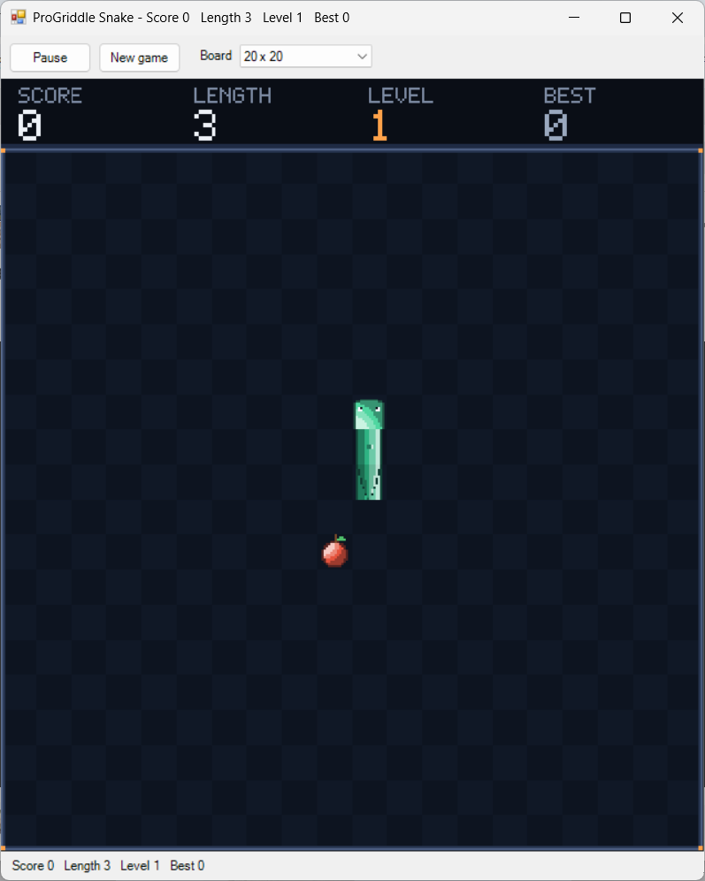

# Snake



The classic: steer a snake round the board, eat the food, grow longer, and do not bite yourself or hit the wall. A real time game on a clock, played from the keyboard. Playable now. Restyled as "Lantern Glass" on a pixel canvas, with effects (see [The look](#the-look)).

## Playing it

From the repository root, or from the Cookoff (`cookoff.bat`), where it has a green button of its own:

```
"C:\Progress\OpenEdge\bin\prowin.exe" -T "%TEMP%\ProGriddle" -l 1024 -p tools/launch.p -param "run/run-snake.p"
```

`tools/launch.p` sets the PROPATH and then runs the named program. Optional entries after the program name: a settings file (`default` for `%APPDATA%\ProGriddle\settings.json`), a number of seconds after which the window closes by itself, and a seed for the food. The automated checks use all three.

A new game waits: a plate on the board asks PRESS AN ARROW KEY (blinking, with an arrow beside the head) and nothing moves until you press one. The key for the way the snake is facing (right) just sets it off, and any other turn key sets it off and turns it. A key that would send it back along its own body does not start it.

### The Board list

The toolbar has a **Board** drop down list with seven sizes, 10 x 10 to 40 x 40 (`15 x 15`, `20 x 20`, `30 x 20`, `30 x 30`, `40 x 30`). Choosing one starts a new game on a board of that size, waiting for a key, and the window remembers the choice for next time. The picture is scaled to fill the window, so the cells get bigger on a smaller board. The window keeps its size when the board changes (and is as big as the screen allows when it first opens).

### Controls

| Input | What it does |
|---|---|
| Arrow keys, or W A S D | Turn the snake |
| P or Space, or the Start and Pause button | Pause and carry on. The board dims and a PAUSED plate shows |
| R or F2, or the New game button | Start again |
| M, or the Sound button | Sound on or off (only when the machine has a sound device) |

A turn is made at the next step. Two quick presses (up, then left) both count, one on each of the next two steps, which is what makes tight turns possible. A key that would send the snake straight back on itself, or that points the way it is already going, is ignored.

### The rules

- The snake moves one cell at a time in the way it is facing. The walls are deadly, and so is its own body.
- Eating the food makes the snake one cell longer and scores 10. A new piece of food appears in a random empty cell.
- It starts at 150 milliseconds a step, and every piece of food takes 5 off, down to 60 at level 19, where it stops getting faster. The status line shows the level.
- The head may move into the cell the tail is just leaving, so a snake can chase its own tail round a ring.
- Filling the whole board wins the game (YOU WIN). Crashing ends it (GAME OVER). The ending is shown for a moment (the crash 0.9 seconds, the win 1.2) before its plate opens.
- A pause, a long stall or a dragged window never makes the snake lurch: the game counts at most half a second of time in one go.

The status line (and the window title) reads `Score 30   Length 6   Level 4   Best 120`, and at the end `Game over   Score 30   Length 6   Best 120   New best score` when the game beat the best.

## The look

The picture is "Lantern Glass", the designer's answer in `docs/design/snake-art.md` (every tile, colour, timing and layout comes from there; Tetris has the same art direction). `SnakePainter` draws it on a pixel canvas: a strip of four numbers (SCORE, LENGTH, LEVEL, BEST) above the board, then the board, a checkerboard of two close floor colours with the snake, the food and a wall ring over the outermost pixels, with an amber lamp in each corner. A cell is a tile of 16 pixels on boards up to 20 cells across and 8 pixels on bigger ones, and the strip is 32 pixels high on a wide picture (320 pixels or more) and 24 on a narrow one, with the numbers at 2x and 1x. The snake is round tubes of jade: the head with eyes and a tongue, body pieces that join to their neighbours (straight and corner, turned to fit), a pointed tail. The apple has a stem and a leaf. Nothing about the rules, keys, speeds or scores changed.

What you see happen (all of it a function of the game's own clock, so a paused game holds still):

| When | What |
|---|---|
| Moving | The tongue flicks out for 100 ms every 600 ms (every 400 while it waits for a key) |
| Food | It beats through four frames, and every fourth beat shows a glint. A new apple grows in over 150 ms |
| Eating | The head flashes white for 66 ms, a ring of eight pixels spreads from the cell, a brighter wave runs down the body (three cells at a time), and the SCORE shows in gold for 300 ms |
| Score over the best | The BEST label blinks NEW BEST in gold and its number follows the score |
| A crash | The whole snake flashes white three times with sparks from the head, then fades out from the tail to the head, then the board dims once |
| GAME OVER | A plate opens from the middle line with the score, LENGTH, NEW BEST (blinking, if beaten) and PRESS R |
| A win | A gold wave runs from the head to the tail twice with sparks rising, then a YOU WIN plate with the same lines |
| Pause | The board dims behind a PAUSED plate (the design has no pause screen: this is the plate of the other screens) |

Left out on purpose, as the design says: a drifting background, a glow round the food, screen shake and a bulging body.

## Sound

Snake has sound effects in the soft, warm voice of the Lantern Glass look: triangle waves with a gentle decay. [Sound](../framework/sound.md) explains how they are made and played. The sounds are written as recipes in `SnakeSounds`, one place for all of them, and `SnakeCues` says when each one happens.

| Cue (`SnakeCue`) | When | Sound |
|---|---|---|
| `Eat` | The snake eats | A small rising blip |
| `Crash` | The snake hits the wall or itself | A slow falling slide |
| `Win` | The snake fills the board | A rising run that ends on a long bright note |

All three are one priority group, so the winning bite is heard as the win only. A new game that is waiting for its first arrow key is silent.

Sound is on unless `sound.on` says otherwise. The M key or the Sound button switches it and saves the choice. With no sound device there is no button and no key, and the game is silent.

## Settings

| Key | Meaning | Default |
|---|---|---|
| `snake.width`, `snake.height` | Board size in cells, 5 to 40, for a first run or by hand. The size chosen in the window (below) wins over these once there is one | 20, 20 |
| `snake.size` | The size chosen in the Board list, such as `30 x 20`, saved when the window closes. A value that is not a size is ignored | none |
| `snake.best` | The best score, kept by the game: it is updated when a game ends with a better one | 0 |

The window also saves `window.width`, `window.height`, `window.x`, `window.y` and `window.maximised` by itself. The best score is one number for every board size. The sound uses two settings shared by every game with sound: `sound.on` (`true` by default, the M key changes it) and `sound.volume` (0 to 100, 50 by default).

## How it uses the framework

| Part | Used here |
|---|---|
| Archetype | Real time: `SnakeGame` implements `IRealTimeGame` on `AbstractGame`, like Tetris |
| Grid | One layer called `view` on an `ArrayStore`, bounded: 0 empty, 1 body, 2 head, 3 food. The painter reads it through the game and draws on a canvas of its own |
| Controller | `RealTimeController` with a `WinFormsClock` ticking every 20 ms. Each tick passes the real elapsed time to the game's `Tick`, and the controller redraws only when a step was made |
| Window | The generic `GameWindow`, told about the game through `SnakeInput` (the arrow keys come in through `HandleKey`, and the Board list through `IGameOptions`, as in Life) |
| Look | `SnakePainter` draws a `PixelCanvas` in direct colour and hands it to the window's `GridView`, which scales it to fill the window (`FitToWindow`, no grid lines) |
| Effects | `SnakeGame` has `Animated`, a clock `ElapsedMs` and the times of events (`LastEatMs`, `FoodMs`, `OverMs`) and implements `IAnimated`. All off unless `Animated`, so the rules tests are unchanged |
| Randomness | An injected `IRandom` places every piece of food, so a seeded one gives the same game every time |
| Settings | `JsonFileSettings`, read by `run/run-snake.p` and by `SnakeInput` |

Source: `src/ProGriddle/Games/Snake/`. The composition root is `run/run-snake.p`.

| Class | Job |
|---|---|
| `SnakeGame` | The rules: steps, turns, food, speed, crashing and winning |
| `SnakeInput` | What the window needs: the keys, the status line and the best score. `BannerText` is always empty, because the painter draws the words, and the input tells the game the best score from before this game so the painter knows when it is beaten |
| `SnakeFactory` | Builds the grid (an `ArrayStore` of one layer) and a game on it, and `Rebuild` changes the board of a running game |
| `SnakeSizes` | The sizes the Board list offers and the limits on a side, using the shared `BoardSizes` of `Engine` to write and read "30 x 20" |
| `SnakePainter` | Draws the Lantern Glass picture from a `SnakeGame` and hands it to the window's renderer. The size follows the board: it starts again when the game's board changes. It bakes the floor, the wall ring, the strip and the body into the background (a step changes four tiles) and draws the food, the head and the effects each frame. It owns canvases and stamps, so its owner calls `Dispose` |
| `SnakeArt` | The tiles of the design at 16 and at 8 pixels, copied exactly: head, head with tongue, straight, corner, tail and four frames of food |
| `SnakeLook` | The colours: `SnakeTint` (an enum of the single colours), the five tone rows made from a base colour (`ToneRow`), the white flash and the steps of the crash fade, and the old four colour palette and text symbols the tests use |
| `SnakePart`, `SnakeDress` (enums) | The five pieces of the snake and the colours it can be drawn in (its own, white, the eat wave, five crash steps, gold) |
| `ViewCode` (an enum) | The numbers the `view` layer holds |

## Tests

All under `tests/ProGriddle/Games/Snake/`.

| Test class | What it proves |
|---|---|
| `SnakeGameTests` | Time and steps, the stall cap, turning (the queue, reversing, repeats), waiting for the first key, eating and growing, where food may go, speed, crashing into each wall and into the body, chasing the tail, winning, `Replace` (a new board), `StartWith`, the contract errors |
| `SnakeInputTests` | The keys, the status line, the banner, the best score, the Board option and the members the game leaves empty |
| `SnakeSizesTests`, `SnakeFactoryTests` | The sizes offered and their limits, and building and rebuilding a board |
| `SnakeLookTests`, `SnakeArtTests` | The named colours, the tone rows against the designer's rows, the flash and the crash fade; the tiles and the refusals |
| `SnakePainterTests` | The picture by pixel: layout at both tile sizes, floor, wall ring, strip, every piece of the body turned to fit, a step and an eat, the head and its tongue, the food, the waiting plate and arrow, the eat flash, ring and wave, pause, the crash, the fade and dim, the game over plate, NEW BEST, the win, and a board of another size |
| `SnakeWindowChainTests` (windowed) | The window's view holds the painter's pixels, and follows a new board size |
| `SnakeCuesTests` | Each sound event of a real game, driven by hand, is reported once (a bite, a crash, a win that covers the last bite), a waiting game is silent, a new game forgets the old one, and the whole chain reaches a recording player |
| `SnakeSoundsTests` | Every cue has a recipe that makes sound and a volume, and the bank fills in well under half a second |

`ScriptedRandom` (in `tests/ProGriddle/Core`, shared with 2048) returns the numbers it is given, so a test chooses exactly where the food goes. Run the tests with `powershell -NoProfile -ExecutionPolicy Bypass -File tools/run-tests.ps1 -Filter "Snake*"`. The window is checked by `tools/gui-smoke-snake.ps1`, which takes over the keyboard for a minute or two.

## Design notes

- **A picture of its own.** As with Tetris, the painter reads the game and never changes it. Every effect is a function of the game's clock (`ElapsedMs` and the times things happened), not state kept between frames, so a pause or a late redraw shows the right picture. Sparks are worked out from their birth time, and `SparkField:AddDragged` gives the crash sparks their drag.
- **Four tiles a step.** The body is baked into the picture's background and a step changes the floor where the tail was, the old head (now body) and the tail, so a long snake on a 40 x 40 board costs no more per step than a short one. The crash is the one moment that redraws many tiles, and when the fade is over the faded and dimmed board is baked once.
- **The picture scales to the window.** `GridView:FitToWindow` scales the canvas by any amount, not whole pixels, so there is no dead space round it: a board change fits the new picture in the same window, and resizing the window grows the picture. The cost is that some pixels are a pixel wider than others at an odd scale.
- **A ring of cell indexes.** The snake is kept as a ring buffer of cells, tail to head, made once. A step writes the new head, clears the tail cell and moves two counters, so it does no allocation and does not search the board. The `view` layer is kept in step and is what the collision test reads.
- **Time, not frames.** `Tick` adds up the real milliseconds it is given and makes a step each time the step length has gone by, so the speed does not depend on how often the clock fires, and the tests drive the game with plain numbers.
- **Two turns can wait.** A single stored turn drops the second key of a quick pair, and an unbounded queue lets a burst of keys steer the snake long after the player stopped. Two is the usual compromise. A turn is checked against the turn before it, not the way the snake is facing now, so up then down is refused even though down is not opposite to the current heading.
- **The random source is asked once per piece of food**, for a number below the count of empty cells, so the food can never land on the snake, and a scripted source can choose the cell.
- **A game that waits for a key.** `SnakeGame:WaitForKey` is off by default, so a test or a script that drives the clock gets a snake that moves. The run file turns it on. Without it, choosing a board size (or pressing R) would start a snake that is already running while the player is still reaching for the keyboard, and on a small board it would crash within a second.
- **Changing the board.** `SnakeGame:Replace` swaps in a new grid and starts a new game on it, disposing the old grid, and `SnakeFactory:Rebuild` is what the Board option calls. Unlike Life, which carries its live cells across, a snake cannot be carried to a different board, so a new size is a new game.
- **Arrow keys and the window.** Snake and 2048 are the first games played with the arrow keys from the first moment, which showed that Windows treats an arrow as a dialog key and swallows it unless the board says it wants it. `GridView:WantsKey` and the window focusing the board when it opens fixed that for every game.
