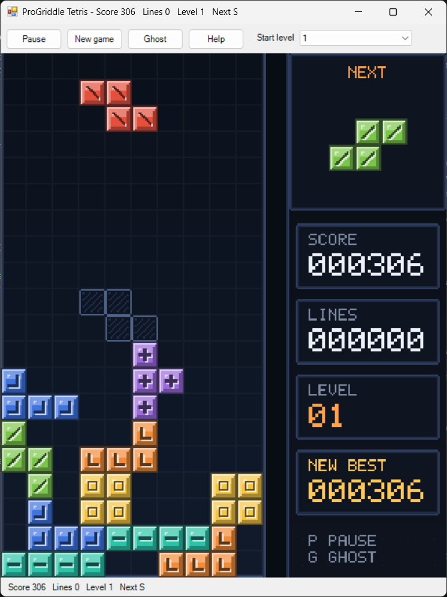

# Tetris



Status: complete and playable. Built in Phase 6 as the first real time game: the pieces fall on a timer whether or not you do anything. Restyled later as "Lantern Glass" on a pixel canvas, with effects (see [The look](#the-look)).

Seven kinds of piece fall one at a time into a ten wide, twenty high well. You slide and turn each piece as it falls and drop it where it fits. A row with no gaps disappears and the rows above it drop down. The game ends when a new piece has no room to appear.

## Playing it

From the repository root:

```
"C:\Progress\OpenEdge\bin\prowin.exe" -T "%TEMP%\ProGriddle" -l 1024 -p tools/launch.p -param "run/run-tetris.p"
```

`tools/launch.p` sets the PROPATH and then runs the named program. Optional entries after the program name: a settings file (`default` for `%APPDATA%\ProGriddle\settings.json`), a number of seconds after which the window closes by itself, and a seed for the pieces. The last two are used by the automated checks.

The game starts as soon as the window opens. The well is on the left. The panel on the right shows the piece that comes next. The status bar and the window title show the score, the lines cleared, the level and the name of the next piece.

### Controls

All play is on the keyboard.

| Key | What it does |
|---|---|
| Left or A | Move left. Repeats while held |
| Right or D | Move right. Repeats while held |
| Down or S | Soft drop: one row down, for a point. Repeats while held |
| Up, W or X | Turn clockwise. Once per press |
| Z | Turn anticlockwise. Once per press |
| Space | Hard drop: straight to the bottom, settle, and the next piece comes. Once per press |
| P, or the Pause button | Pause and resume. The well dims and PAUSED shows on a plate |
| F2 or R, or the New game button | Start a new game |
| G, or the Ghost button | Show or hide the ghost piece |
| M, or the Sound button | Sound on or off (only when the machine has a sound device) |
| H, or the Help button | Show the high scores, the keys and the scoring |
| Start level box | Choose the level a new game starts at, 1 to 10 |

A held key keeps arriving from the keyboard, and the movement keys use that as key repeat, as every Tetris does. Turning and the hard drop would be a mistake to repeat, so while one of those keys is held its repeats are ignored until it comes up. The window tells the game when a key comes up, and when the window loses the focus every key counts as up, so no key can stay stuck.

The start level box changes the level at once if nothing has settled yet. In the middle of a game it applies to the next new game, and a notice says so. Open the list first (click it) to use the arrow keys on it: while the list is closed the arrow keys belong to the game.

### The rules

- **The pieces** are the seven tetrominoes: I, O, T, S, Z, J and L, in the usual colours (I teal, O gold, T amethyst, S leaf green, Z vermilion, J cobalt, L tangerine). A piece appears at the top in the middle.
- **The seven bag.** The pieces come from a bag of all seven, shuffled and dealt one at a time, and then a new shuffled bag. So every piece comes round once in every seven, the same piece never comes more than twice in a row, and a long wait for an I is at most 12 other pieces.
- **Gravity.** A piece falls one row every so many milliseconds, set by the level (below). A piece resting on something is settled by the next gravity step, which leaves a moment to slide it sideways.
- **Turning.** A piece turns about its middle. If it would not fit there, the game tries one and two cells to the left and right, then one cell up (also to either side), then one cell down, and refuses the turn only when none of them fit. That lets a piece turn beside a wall or on a stack.
- **Lines.** A full row disappears and the rows above drop. Clearing 1, 2, 3 or 4 rows at once scores 100, 300, 500 or 800, each times the level. The game holds still while the rows are shown clearing: 300 ms, and 420 ms for four rows (`ClearDelayMs`). Nothing can move during it.
- **Dropping.** A soft drop scores 1 point for every row it moves, a hard drop 2 points a row.
- **Levels.** The level starts at the start level and goes up by one for every 10 lines cleared, to a top of 30.
- **The ghost** is a dim copy of the piece where it would land if dropped now. It can be turned off, and the choice is remembered.
- **Game over.** When a new piece has no room at the top the game ends, the well fills with dead blocks, a GAME OVER plate opens with your score, and the keys stop. F2 or R starts again.
- **High scores.** The ten best scores are kept, best first, each with the lines cleared in that game. When a game ends its score goes on the list if it is good enough, once, and the status line says "New best score" or "High score, place N". A score ties below an older equal one, and a game that scores nothing is not listed. While a best score exists the status line ends with "Best N". The list is at the top of the Help screen (H).

| Level | Milliseconds between steps |
|---|---|
| 1 | 800 |
| 2 | 725 |
| 3 | 650 |
| 5 | 500 |
| 10 | 125 |
| 11 and up | 50 |

The speed is 800 minus 75 for each level above the first, and never under 50.

## The look

The picture is "Lantern Glass", the designer's answer in `docs/design/tetris-art.md` (every tile, colour, timing and layout comes from there). It is drawn by `TetrisPainter` on a pixel canvas 272 x 320 pixels (17 x 20 cells of 16 pixels): the well, a divider, and a panel with the next piece and four cards (SCORE, LINES, LEVEL, HI-SCORE). The window is shaped to it and shows it 2 or 3 times as big. Each block is a 16 x 16 tile of five tones with a mark of its own for each piece. The rules, keys, speeds and scores are as they were.

What you see happen (all of it a function of the game's clock, so a paused game holds still):

| When | What |
|---|---|
| A piece settles | Its blocks flash lit for 50 ms, then with a white highlight for 50 ms, with up to 8 sparks from the blocks that sit on something. The NEXT piece also shows lit for 50 ms |
| A hard drop | A two pixel streak in each column fades through three tones in 150 ms, and a line grows along the landed piece's bottom edge |
| Rows clear | The rows go lit, then solid white, then turn to floor from the middle out, with gold sparks. The score shows gold for 400 ms. Four rows begin in gold, take 420 ms, show the word TETRIS for half a second and keep the score gold for 800 ms |
| Level up | A gold line rises through the empty cells of the well, the LEVEL card's border turns amber for 480 ms, and the level number blinks |
| The stack is in the top four rows | The left and bottom walls pulse red, 250 ms on and 250 ms off |
| Pause | The well dims (55 percent towards near black) behind a PAUSED plate |
| Game over | The well fills with dead blocks from the bottom, a row every 40 ms; the plate opens; GAME OVER appears a letter at a time; then the score, NEW BEST (blinking) if the game beat the best from before it, and PRESS R |
| The score passes the best | HI-SCORE becomes NEW BEST in gold, follows the score, and its card flashes amber for 600 ms |

The window is as big as the screen allows when it opens, and the picture is scaled to fill the window by any amount (`GridView:FitToWindow`), so there is no dead space round it and resizing the window grows the picture.

Left out on purpose, as the design says: a moving background, screen shake, bloom and a glow round a clearing row. The start up animation (the falling TETRIS word) is also not built: only the panel appearing at once, because the game starts as soon as the window opens.

## Sound

Tetris has sound effects in the soft, warm voice of the Lantern Glass look: triangle waves with a gentle decay, none of them loud. [Sound](../framework/sound.md) explains how they are made and played. The sounds are written as recipes in `TetrisSounds`, one place for all of them, and `TetrisCues` says when each one happens.

| Cue (`TetrisCue`) | When | Sound |
|---|---|---|
| `Lock` | A piece settles | A short muffled thud, falling in pitch |
| `Clear` | One to three rows clear | Three rising soft notes |
| `Tetris` | Four rows clear at once | A longer rising run that ends on a high held note |
| `LevelUp` | The level goes up | A quick climbing run to a bright note, with the clear or the lock |
| `GameOver` | The stack reaches the top | A slow falling slide |
| `Danger` | The stack first rises into the top four rows | A low double note |

A lock, a clear, a Tetris and the end of the game are one priority group, so when a piece locks and clears rows you hear the clear, not both. The level up and the danger are groups of their own and sound along with them. The moves and turns make no sound: the game keeps no time for them.

Sound is on unless `sound.on` says otherwise. The M key or the Sound button switches it and saves the choice, and the Help screen lists the key. With no sound device there is no button and no key, and the game is silent.

## Settings

The window saves `tetris.choice` (the start level) and its own `window.width`, `window.height`, `window.x`, `window.y` and `window.maximised`, which are shared with the other games. The game itself reads and saves two settings:

| Setting | Meaning | Default |
|---|---|---|
| `tetris.ghost` | `true` to show the ghost piece. The G key and the Ghost button change it and save it | `true` |
| `tetris.scores` | The high score list as `score:lines` pairs, best first, for example `12400:32,9800:25`. Anything that is not a pair with a score of 1 or more is dropped when it is read | empty |

The sound uses two settings shared by every game with sound: `sound.on` (`true` by default, the M key changes it) and `sound.volume` (0 to 100, 50 by default).

## How it uses the framework

| Part | Used here |
|---|---|
| Archetype | Real time: `TetrisGame` implements `IRealTimeGame` on `AbstractGame`. `Tick` is given the milliseconds that passed and adds them up, so gravity does not depend on how often the clock fires. The moves are methods of the game |
| Grid | One layer, `view`, bounded: the 10 x 20 well, a divider column, and a panel six cells wide for the next piece. The game keeps one number per cell up to date after every change and the window turns it into a colour |
| Playfield | A second `TableStore` of its own, exactly the size of the well, with the layers `locked` (0 empty, else the number of the piece that settled there) and `active` (the falling piece) |
| Store | `TableStore`. The store's row operations (`IsRowFull`, `ShiftRowsDown`, `Stamp`, `Erase`) work on whole rows, so they have to work on a store that is only the well, which is why the playfield is separate from the shared grid |
| Controller | `RealTimeController`: starts and stops the clock, pauses the game, and redraws only when `Tick` says something changed |
| Clock | `WinFormsClock` at a 30 ms interval, which is smooth enough for twenty rows and redraws only when something moved. It reports the time that really passed, so a late tick costs the game no time |
| Window | The generic `GameWindow`. `TetrisInput` describes the game to it through `IGameInput`: the keys, the banner, the start level picker, the Ghost command and the Help screen |
| Drawing | `TetrisPainter` draws a `PixelCanvas` of its own in direct colour and hands it to the window's `GridView` (no grid lines). The game's own `view` layer is untouched and still tested |
| Effects | `TetrisGame` has `Animated`, `ClearDelayMs` and readers for when things happened (`ElapsedMs`, `LastLockMs`, `LastClearMs`, `LevelUpMs`, `OverMs`, `Danger`). It implements `IAnimated` so the clock keeps running while the picture is moving. All off unless `Animated`, so the rules tests are unchanged |
| Randomness | `SeededRandom` through `IRandom`, so a seed gives the same pieces every time |
| Settings | `JsonFileSettings`, read by `run/run-tetris.p`, the input and the window |

Source: `src/ProGriddle/Games/Tetris/`. The composition root is `run/run-tetris.p`.

| Class | Job |
|---|---|
| `TetrisGame` | The game and all the rules above. The moves, `Tick`, `GhostY`, `StartWith` (the first pieces, for tests), `LoadLocked` (the settled blocks from text, for tests) and readers for each layer |
| `PieceBag` | The seven bag, dealing from an `IRandom` |
| `Tetrominoes` | The seven shapes and their four turns, and the names |
| `TetrisInput` | The `IGameInput`: the keys and their repeat rules, the picker, the Ghost command, the banner, the status line, the Help text and recording a finished game's score |
| `TetrisHighScores` | The ten best scores in the settings: `Record` returns the place, `Best`, `ScoreAt`, `LinesAt` |
| `TetrisPainter` | Draws the Lantern Glass picture from a `TetrisGame` and hands it to the window's renderer. It keeps a base canvas (background, floor, walls, divider, card frames) and bakes the settled stack into the picture's background, adding four tiles per lock. It owns canvases and stamps, so its owner calls `Dispose`. Takes an `IRandom` for the speeds of sparks |
| `TetrisArt` | The tiles of the design, copied exactly: the blank block, the seven marked blocks, the ghost and the floor |
| `TetrisLook` | The colours: `Tint` (an enum of the single colours), the five tone rows of the pieces, the dead blocks and gold, the lit and white top variants, and the symbols used to draw a board as text in tests |
| `TetrisFactory` | Builds the grid, the playfield and the game, for the usual board or one of another size |
| `ViewCode` (an enum) | The meaning of each `view` value: 0 empty, 1 to 7 a piece of I O T S Z J L, 8 ghost, 9 divider, 10 panel |

### What the framework had to learn

Tetris was the first game that runs on a clock without being stepped, so the framework changed rather than the game working round it:

- **Real time games.** `IRealTimeGame` (a `Paused` flag and `Tick`) and `RealTimeController` are new. The controller is built paused, stops the clock by itself when the game is over, and `Reset` starts a new game and runs it.
- **Pausable.** `IGameController` gained `Pausable`. A steppable game has Start, Step, Reset and a speed slider; a real time game can only pause, resume and start again. The window shows one Pause or Start button and answers to P, hiding the stepping and the speed.
- **Game keys.** `IGameInput` gained `HandleKey` and `ReleaseKey`. The window offers every key press to the game first, so a game can use the arrows and the space bar for itself, and tells it when a key comes up, or (with an empty name) when every key does because the window lost the focus.
- **A banner.** `IGameInput` gained `BannerText` and `GridView` gained `SetBanner`: text kept over the middle of the board for as long as it is not empty. Tetris once used it for PAUSED and GAME OVER; now the painter draws both, so `TetrisInput:BannerText` is always empty.
- **A pixel canvas for a restyle.** Later work added `Tile` (a tone map picture that colours into a `PixelStamp`), `TextStampCache`, `SparkField` (sparks worked out from the time), `IAnimated` (a game that is moving tells the controller to keep the clock running), `PixelCanvas` `BakeView`, `LoadBack`, `Dim` and `DimRect`, and `ColourMath` `ToHex` and `Scale`. They are shared with Snake's restyle and used by Asteroids.
- **The real time that passed.** `WinFormsClock` now tells its listeners how many milliseconds really went by since the last tick, instead of the interval it was asked for.

## Tests

All under `tests/ProGriddle/Games/Tetris/`, plus the framework tests next to the pieces they cover.

| Test class | What it proves |
|---|---|
| `TetrisGameTests` | Every rule above: spawning, moving against walls and stacks, turning and its kicks, gravity with a fake clock, settling, line clears of one to four rows, scoring and levels, the ghost, pause, game over, and the grid checks |
| `TetrisInputTests` | The key map, key repeat for the movement keys and once per press for turning and the hard drop, `ReleaseKey`, the banner, the picker, the Ghost command and its setting, the status line and the Help text |
| `PieceBagTests` | Every seven pieces are all seven, the spacing limits, the same seed deals the same pieces, `Preset` |
| `TetrominoesTests` | The shapes and their turns |
| `TetrisHighScoresTests` | Ranking, ties, the ten place limit, scores of nothing, a hand edited list, places off the list |
| `TetrisFactoryTests` | What the factory builds |
| `TetrisLookTests` | The look lines up with the view codes |
| `TetrisAnimationTests` | The game's effect clocks: the clear freeze, the lock, clear and level up times, game over, danger |
| `TetrisPainterTests` | Every part of the picture by pixel: background, floor, walls, cards, next piece, piece, ghost, stack, numbers, the lock flash and sparks, the hard drop trail and impact, the clear wipe, sparks and TETRIS word, the level up sweep and blink, pause, game over, NEW BEST, danger walls |
| `TetrisWindowChainTests` (windowed) | The window's view holds the painter's pixels |
| `TetrisCuesTests` | Each sound event of a real game, driven by hand, is reported once and in order (the clear before the lock, the end first), the danger once, a new game forgets the old one, and the whole chain reaches a recording player |
| `TetrisSoundsTests` | Every cue has a recipe that makes sound and a volume, and the bank fills in well under half a second |
| `RealTimeControllerTests` (Engine) | The real time controller, driven with a fake clock |

Run them with `powershell -NoProfile -ExecutionPolicy Bypass -File tools/run-tests.ps1 -Filter "Tetris*"`.

## Checking the window

`tools/gui-smoke-tetris.ps1` launches the real window with a throwaway settings file and a fixed seed and plays: moving left and right, turning with Up, Z and X, held Left and Right repeating to the walls, a soft drop and a held soft drop scoring, gravity with no key pressed, the ghost off and on, P pausing (nothing moves, the well dims behind the PAUSED plate) and resuming, F2, a hard drop, a held Space dropping only one piece, the Help screen opening and closing, stacking pieces to a game over (a new best score, and the keys then do nothing), F2 again, the start level picker, and then a second run that reads the saved level, ghost setting and high score back. It reads the score and level from the window title and the well from a screenshot: the board is placed from the fill of the panel cards, and each cell is read at one pixel (3 across and 3 down, tone 2 of the block, the floor of the row or the hatch of the ghost). The script was updated for the Lantern Glass look but has not been run since. It sends real keystrokes and mouse clicks to the foreground, and holds keys down with `keybd_event` to get real key repeat, so leave the keyboard and mouse alone for the couple of minutes it takes. Screenshots go to `build/screenshots`.

```
powershell -NoProfile -ExecutionPolicy Bypass -File tools/gui-smoke-tetris.ps1
```

### Manual checklist

- [ ] The fall is smooth with no flicker, at level 1 and at a high start level.
- [ ] Held keys repeat at a comfortable speed, and a held turn or Space does not repeat.
- [ ] The PAUSED and GAME OVER plates are easy to read over the stack.
- [ ] The lock flash, the clear wipe and the level up sweep look right and the 300 ms freeze on a line clear feels fair.
- [ ] The ghost is easy to tell from a settled piece.

## Design notes

- The playfield is not part of the shared grid. A first version kept the locked and active layers in the grid beside the view, and failed because the store's row operations span the whole width of the grid, so a full row of the well was never a full row of the grid. A store of its own, the size of the well, makes `IsRowFull` and `ShiftRowsDown` mean exactly what the game needs.
- `Tick` adds up the time it is given and runs as many gravity steps as are due, so a slow tick makes the pieces fall in a lump rather than slowing the game, and a test with a fake clock is exact.
- A piece rests on the floor until the next gravity step settles it. There is no lock delay that resets when you slide, so a piece cannot be held in the air for ever.
- Turning tries a short list of nearby places in a fixed order instead of the full rotation systems of the official game. It is simple, predictable and covers the cases that matter (turning against a wall, or on a stack).
- A game is put on the list by the input, the first time it is asked about a finished game, because the window asks for the status line after every tick and key and the game itself knows nothing of settings. A new game clears the flag, so every game is recorded once.
- The painter reads the game and never changes it. Every effect is a function of the game's own clock (`ElapsedMs` and the times things happened), not state kept by the painter between frames, so a pause or a late redraw shows the right picture. Sparks are worked out from their birth time, so ones for a whole clear can be made at once with births in the future.
- The line clear freezes the game (300 ms, 420 ms for four rows) so the animation can play, and nothing can move meanwhile. It is a setting of the game (`ClearDelayMs`, 0 clears at once), so every rules test still clears at once.
- The key repeat rule lives in the game's input, not in the window, so the window stays generic: it only reports key down, key up and loss of focus.
